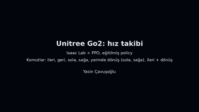

# go2-velocity-tracking

[](LICENSE)
[](https://github.com/isaac-sim/IsaacLab)
[](https://www.python.org/)

**Velocity-command tracking for the Unitree Go2 quadruped**, trained from scratch with **PPO in Isaac Lab**. A single
policy follows forward, lateral and yaw-rate commands with a trot gait in every direction. Most of the work went into
reward design and into catching **reward hacking** with physical measurements instead of trusting the reward curve.



## Results

Final policy: `logs/2026-10-14_18-29-11/model_1499.pt`. Averages skip the first 0.5 s after every command change.

| Motion | Command | Measured (mean of 4 robots) |
|---|---|---|
| Forward | Vx 0.80 m/s | 0.81 m/s |
| Backward | Vx −0.50 m/s | −0.47 m/s |
| Left | Vy 0.40 m/s | 0.39 m/s |
| Right | Vy −0.40 m/s | −0.39 m/s |
| Turn in place, left | 0.80 rad/s | 0.78 rad/s |
| Turn in place, right | −0.80 rad/s | −0.82 rad/s |
| Forward + left turn | 0.50 m/s, 0.80 rad/s | 0.53 m/s, 0.78 rad/s |

- **16 robots** with different friction and added mass: mean deviation from the commanded velocity **3.6 %**, worst
  case **7.1 %**.
- **Full command sweep**, 26 commands across Vx −1…1 m/s, Vy −0.6…0.6 m/s and yaw rate −1…1 rad/s plus mixed
  commands: **no falls**, trot gait for every command (diagonal foot-contact correlation 0.93–0.99).
- **Training:** 2,048 parallel robots, 1,500 PPO iterations (73.7 M steps, about 410 h of simulated experience) in
  **17.3 min** on a single RTX 4060 Laptop GPU, seed 42.

## How it works

**Observation (48 values):** base linear and angular velocity, projected gravity, velocity command, joint positions
relative to the default pose, joint velocities and the previous action. Sensor noise is injected during training.

**Action (12 values):** joint position targets, `default pose + 0.25 × action`. A PD controller (Kp 25, Kd 0.5) on a
DC-motor model (23.5 Nm, 30 rad/s) turns targets into torque. Physics runs at 200 Hz, the policy at 50 Hz.

**Commands:** Vx ±1 m/s, Vy ±0.6 m/s, yaw rate ±1 rad/s, resampled every 10 s. 10 % of the commands are
turn-in-place and 2 % are stand-still.

**Domain randomization:** ground friction (static 0.5–1.25, dynamic 0.4–1.0), added base mass (−1…+3 kg) and random
pushes (±0.5 m/s every 10–15 s). Self-collision is enabled.

**Reward (14 terms):**

| Term | Weight | Purpose |
|---|---|---|
| Linear velocity tracking, exp(−e² / 0.25) | 1.5 | follow Vx and Vy |
| Yaw-rate tracking, exp(−e² / 0.25) | 0.75 | follow the yaw rate |
| Trot gait: diagonal foot pairs in sync (adapted from Isaac Lab's Spot example) | 1.0 | stable gait |
| Feet air time, threshold 0.5 s | 1.0 | longer, cleaner steps |
| Joint torque² | −2e-4 | energy |
| Joint acceleration² | −2.5e-7 | smooth motion |
| Action rate² | −0.01 | smooth motion |
| Foot slip: squared foot speed while in contact | −0.1 | no sliding |
| Thigh or calf contact | −1.0 | walk on the feet only |
| Foot spacing below 10 cm between left and right feet | −10 | no leg crossing |
| Joint position limits, soft limit at the middle 90 % of the range | −10 | stay off mechanical stops |
| Vertical base velocity² | −2.0 | stable base |
| Roll and pitch rate² | −0.05 | stable base |
| Base tilt | −2.5 | stay level |

**PPO (rsl_rl):** 24 steps per robot per iteration, 4 mini-batches × 5 epochs, clip 0.2, entropy coefficient 0.01,
adaptive learning rate (target KL 0.01), γ 0.99, λ 0.95, actor and critic 3 × 128 ELU.

## Reward hacking: what went wrong and how it was found

The reward curve looked fine at every stage. Each problem below was found by watching the video frame by frame and then
**measuring** it: foot-contact patterns, joint angles against their limits and the distance between the feet.

1. **Hopping.** With the default feet-air-time weight (0.25) the robot moved forward in short four-legged hops.
   Weight 1.0 gave a trot when walking forward.
2. **Pace and no turning in place.** Walking sideways the gait broke down (diagonal contact correlation 0.24), and
   turn-in-place reached 0.26 rad/s instead of 0.8. Uniformly sampled commands almost never contain a pure turn;
   making 10 % of the commands turn-in-place fixed it.
3. **Hopping came back** after that change, this time when walking forward. An explicit trot reward fixed the gait in
   every direction.
4. **Leaning on the knee limit.** The front-left knee sat within 3° of its mechanical limit 48 % of the time. In
   simulation the limit is free support that costs no torque, so it lowered the energy penalties; on hardware the joint
   would hit the stop at every step. A joint-limit penalty keeps the knees clear.
5. **Legs passing through each other.** During turns the hind feet came within 3–9 cm and even crossed, because
   self-collision is disabled in the stock Go2 asset. Enabling self-collision and adding calf-contact and foot-spacing
   penalties brought the median hind-foot spacing to 17 cm with no contact between the legs.

## Limitations

- Backward walking is slightly slow (−0.47 for −0.50 m/s).
- Very slow forward commands overshoot (0.25 for 0.2 m/s).
- On a stand-still command the robot keeps trotting in place and drifts by about 0.07 m/s.
- Low foot clearance (about 4 cm): fine on flat ground, not enough for rough terrain.
- Flat ground only. The base linear velocity is observed directly, so running on hardware needs a state estimator or
  teacher–student training.
- Each configuration was trained with a single seed.

## Run

Tested with Ubuntu 22.04, Isaac Sim 5.1, Isaac Lab 2.3.2, rsl_rl 3.1.2 and Python 3.11. Run from the Isaac Lab
directory; `REPO` is the path to this repository.

```bash
./isaaclab.sh -p REPO/go2_hiz_takibi.py train --headless
./isaaclab.sh -p REPO/go2_hiz_takibi.py play --headless --video --checkpoint REPO/logs/2026-10-14_18-29-11/model_1499.pt
```

`play` loads the policy, drives four robots through a fixed command sequence (forward, backward, left, right, turns in
place, forward with a turn) and prints the measured mean velocity of every segment.

Evaluation tools in `araclar/` use the bundled policy by default. The `MODEL`, `ROBOT` and `CIKTI` environment
variables override the policy, the number of robots and the output folder.

| Script | What it does |
|---|---|
| `hiz_taramasi.py` | full command sweep, 26 commands on 16 robots, writes `sonuclar/tarama/` |
| `detayli_deger.py` | 16 robots through the `play` command sequence, writes `sonuclar/detay16/` |
| `dd_analiz.py` | tracking error, settling time and foot synchronization for every segment |
| `hareket_olcum.py` | joint angles against their limits and foot height |
| `bacak_mesafe.py` | distance between the left and right feet |
| `olcum_analiz.py` | summary of joint limits, foot height and foot spacing, `sonuclar/olcumler.txt` |
| `video_yazi.py` | overlays the command and the measured velocity on the video |

```bash
./isaaclab.sh -p REPO/araclar/hiz_taramasi.py
python -m pytest REPO/testler -q
```

The tests check the reward functions with plain PyTorch, without starting the simulator.

## Repository layout

```text
go2_hiz_takibi.py             environment, rewards, PPO settings, train and play
logs/2026-10-14_18-29-11/     final policy (model_1499.pt) and training parameters
araclar/                      evaluation and measurement scripts
testler/                      unit tests for the reward functions
sonuclar/                     evaluation outputs (text, JSON, CSV)
video/                        evaluation video with four robots
docs/                         README media
```

## License

[MIT](LICENSE)
